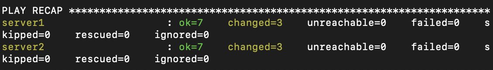

# Laboratorio de Automatización con Ansible y Docker

## 1. Descripción del proyecto

Este proyecto consiste en la administración y automatización de dos servidores Ubuntu utilizando Ansible y Docker.

Se utiliza Ansible para ejecutar tareas de manera simultánea en ambos contenedores, permitiendo administrar directorios, archivos y consultar información del sistema operativo.

## 2. Tecnologías utilizadas

- Ansible
- Docker
- Docker Compose
- Ubuntu 24.04
- Python 3

## 3. Estructura del proyecto

```text
ansible-lab/
├── docker-compose.yml
├── inventory.ini
├── playbook.yml
├── README.md
└── captura-ejecucion.png
```

## 4. Configuración del laboratorio

Se crearon dos contenedores Ubuntu 24.04 mediante Docker Compose:

- server1
- server2

Para iniciar los contenedores se utiliza:

```bash
docker compose up -d
```

Se instaló Python 3 en ambos contenedores para permitir la ejecución de las tareas de Ansible.

## 5. Configuración de Ansible

El archivo `inventory.ini` contiene los dos servidores administrados mediante el plugin de conexión Docker de la colección `community.docker`.

Para comprobar la conexión se ejecuta:

```bash
ansible docker -i inventory.ini -m ping
```

## 6. Tareas realizadas

El archivo `playbook.yml` ejecuta las siguientes tareas:

1. Mostrar el nombre de cada servidor.
2. Identificar el sistema operativo y su versión.
3. Crear el directorio `/tmp/ansible-demo`.
4. Crear el archivo `info.txt` con información del servidor.
5. Crear las carpetas `logs`, `backup` y `config` mediante un loop.
6. Mostrar un mensaje cuando el sistema operativo sea Ubuntu.

## 7. Ejecución del proyecto

Para verificar la sintaxis del playbook:

```bash
ansible-playbook -i inventory.ini playbook.yml --syntax-check
```

Para ejecutar las tareas:

```bash
ansible-playbook -i inventory.ini playbook.yml
```

## 8. Resultados

La ejecución finalizó correctamente en ambos servidores:

- **server1:** 7 tareas correctas, 3 cambios y 0 fallos.
- **server2:** 7 tareas correctas, 3 cambios y 0 fallos.

Se confirmó la creación de los directorios y archivos solicitados en ambos contenedores.

## 9. Evidencia de ejecución



